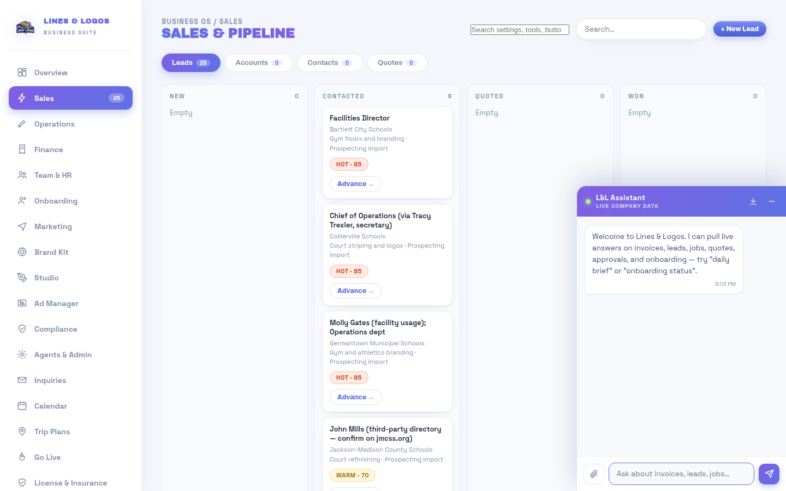
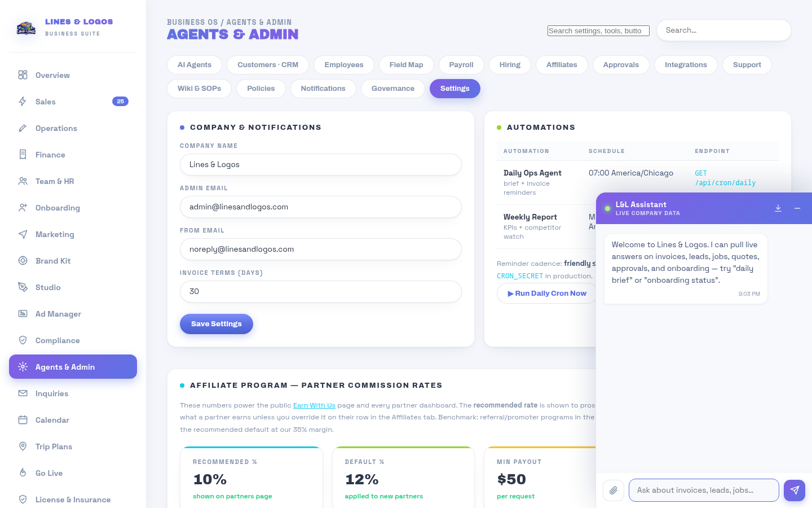
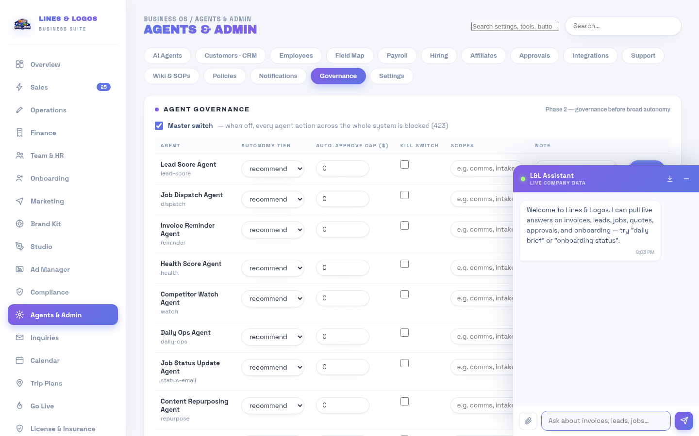
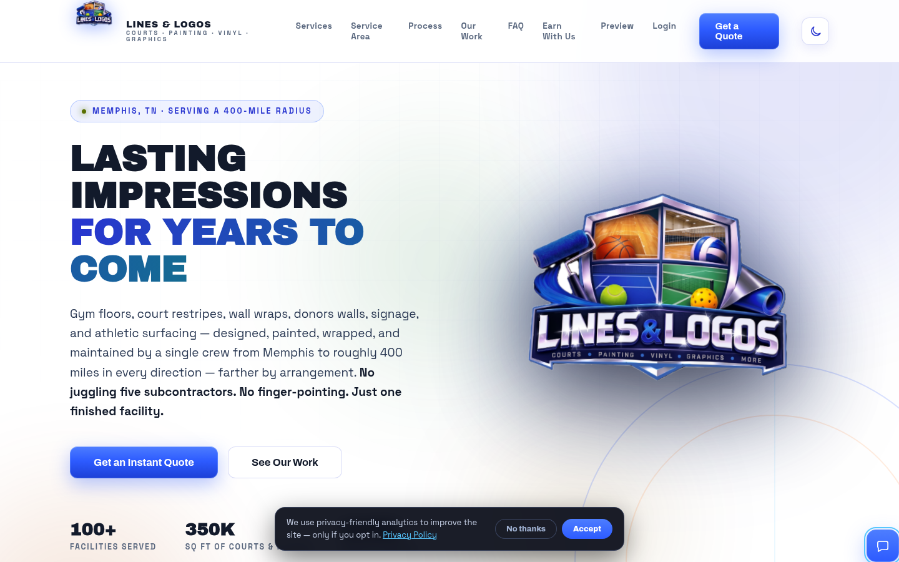
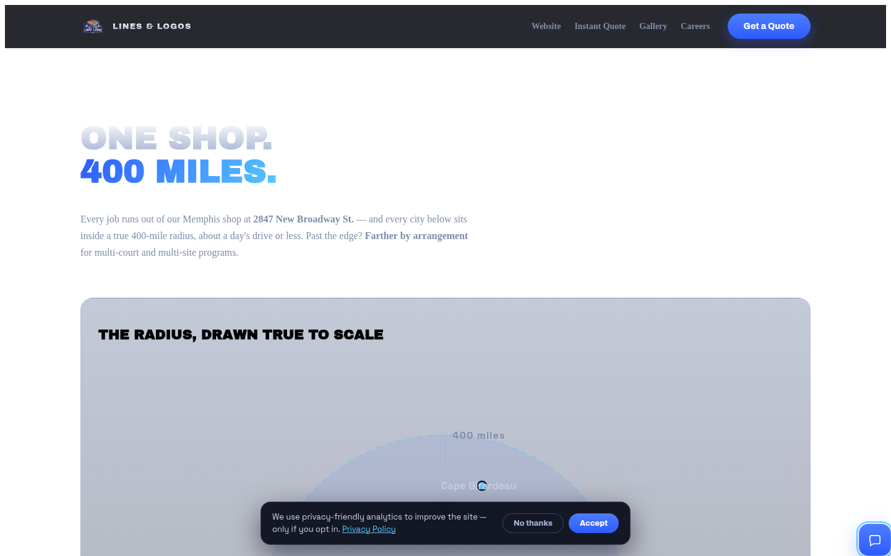

## Deploy on a VPS (Debian/Ubuntu)

**Option A — one-click .deb:** `sudo dpkg -i lines-logos_1.0.0-all.deb && sudo apt-get -f install` (asks for all API keys with signup/retrieval instructions, creates the service, starts on boot).

**Option B — interactive installer:** `sudo bash scripts/install-vps.sh` (asks for port, optional domain with automatic HTTPS via Caddy, all API keys — everything skippable and redoable later in the app).

**Option C — Docker:** `docker compose up -d --build` (data persists in the `lines-logos-data` volume; all keys optional via compose `environment:`).

**Option D — Windows installer (NSIS):** run `LinesAndLogos-BusinessOS-Setup.exe` — bundles Node.js, installs to Program Files, optional start-menu/startup shortcuts and firewall rule. Rebuild with `makensis scripts/installer.nsi`.

**First run:** open `http://<server-ip>:3001/login.html` — the first person to open it creates the owner account (one-time). The go-live checklist inside the app then handles Stripe live keys, Tax activation, and the webhook secret. API keys can be added any time at **Admin → Keys & Integrations** (signup links and retrieval steps built in).

**Desktop & mobile apps:** `electron/` (Windows/macOS — login-first desktop app, standalone or remote-server mode) and `capacitor/` (Android/iOS client — asks for your server address once, then opens the login page). See each folder's README.

**Demo data:** set `LL_DEMO_USERS=1` to seed the demo owner/crew accounts; fresh deployments start with no users by design.

---

<pre align="center">
██╗     ██╗███╗   ██╗███████╗███████╗    ██╗      ██████╗  ██████╗  ██████╗ ███████╗
██║     ██║████╗  ██║██╔════╝██╔════╝    ██║     ██╔═══██╗██╔════╝ ██╔════╝ ██╔════╝
██║     ██║██╔██╗ ██║█████╗  ███████╗    ██║     ██║   ██║██║  ███╗██║  ███╗█████╗
██║     ██║██║╚██╗██║██╔══╝  ╚════██║    ██║     ██║   ██║██║   ██║██║   ██║██╔══╝
███████╗██║██║ ╚████║███████╗███████║    ███████╗╚██████╔╝╚██████╔╝╚██████╔╝███████╗
╚══════╝╚═╝╚═╝  ╚═══╝╚══════╝╚══════╝    ╚══════╝ ╚═════╝  ╚═════╝  ╚═════╝ ╚══════╝
                        B U S I N E S S   O S
</pre>

<h2 align="center">The full back office for a regional athletic-surfacing contractor</h2>

<p align="center">
  <a href="https://github.com/projectzerodays/lines-and-logos"></a>
  
  <a href="LICENSE"></a>
  
  <a href="#api-documentation"></a>
  <a href="#security-considerations"></a>
  
  
</p>

---

A single zero-dependency Node.js server that runs the entire company: CRM and intelligent pipeline, instant quoting through invoices and payments, field dispatch and travel logistics, a complete applicant-tracking system, payroll, taxes, filings, the corporate book, an AI agent workforce with governance and BYOK model routing (OpenRouter free by default, local Hugging Face model hosting), a customer portal, and the public marketing site.

**One process. One data file. No build step.**


*Business OS dashboard — pipeline health, agent activity, and finance KPIs on the Argon-style light theme.*

## Executive summary

- **All-in-one back office** — sales, ops, finance, HR, marketing, and legal operations in one audited system
- **Zero dependencies** — `node server.js` runs the entire company; persistence is a single JSON file with atomic saves
- **31 AI agents with governance** — autonomy tiers, dollar caps, master + per-agent kill switches, audit trail, evaluation harness
- **BYOK model routing** — 14 provider presets; OpenRouter free models are the default; local GGUF models can run on the same machine
- **Honest by design** — no invented prices, testimonials, or certifications; verified data carries provenance; simulated email/SMS is clearly marked
- **CRM seeded with 25 real qualified prospects** (16 fully researched: named facilities contacts, verified phones/emails/addresses)
- **256 API routes**, 38 pages, browser-verified desktop + mobile with zero console errors

## Table of contents

- [Features](#features)
- [Architecture](#architecture)
- [Repository structure](#repository-structure)
- [Installation](#installation)
- [Dependencies](#dependencies)
- [Configuration](#configuration)
- [Usage](#usage)
- [CLI reference](#cli-reference)
- [API documentation](#api-documentation)
- [Reporting](#reporting)
- [Logging](#logging)
- [Security considerations](#security-considerations)
- [Troubleshooting](#troubleshooting)
- [FAQ](#faq)
- [Glossary](#glossary)
- [Project statistics](#project-statistics)
- [Performance notes](#performance-notes)
- [Roadmap](#roadmap)
- [Contributing guidelines](#contributing-guidelines)
- [Code of conduct](#code-of-conduct)
- [Support](#support)
- [Author](#author)
- [License](#license)
- [Acknowledgments](#acknowledgments)
- [Disclaimer](#disclaimer)

## Features

| Domain | Capabilities |
| --- | --- |
| Sales & CRM | Kanban pipeline, lead scoring/tiers, 25 real researched prospects with verified contacts, outreach drafts with AI polish, approval-gated sending, drip sequences, follow-up queue with operator reminders |
| Quoting | Public instant-quote calculator (line items + tax), quote requests → pipeline, estimates → invoices → payments, approval required for price changes |
| Field operations | Dispatch board, crew scheduling, trip planner with per-diem engine, POs for hotels/equipment/rentals, mileage reimbursement, consent-gated crew location |
| Finance | Invoices, payments, aging, AR reminders, AP approvals, payroll runs (W2/1099), bulk payouts, tax due-date reminders, expense capture |
| Spend intelligence | Subscription/duplicate/anomaly audit → admin flags, transaction Q&A ("what was the $214.50 charge?") |
| HR / ATS | Resume upload (validated + magic-byte sniffed + staff-only download), consent-gated comms, candidate self-booking via token links, interview reminders, e-sign hire packets, 8-status pipeline with audit history, referral program ($500/90d), trade-school apprentice track |
| Purchasing | Vendor registry with negotiated terms (net days, early-pay discounts, corporate accounts), purchase orders, dropship order lifecycle with margin capture, inventory with low-stock alerts |
| Corporate & legal | Corporate book (minutes, bank resolutions, charter — with vote tallies), registered-agent record, annual filings tracker, policies, insurance/licensing registers with expiry alerts |
| AI workforce | 31 agents, governance (tiers/caps/kill switches/audit/eval harness), BYOK panel: OpenRouter free default + Anthropic, OpenAI, Gemini, Copilot, Venice, Z.ai, Tasker, Nemus, Numes, Agnes, Alliteration, self-hosted LM Studio, **local Hugging Face GGUF hosting** |
| Marketing | Campaign manager (budget/channel/ROI), newsletter engine, social post drafts → approval → scheduling, SEO audit engine (daily, 10 pages, 100%), gallery with admin approval, client-approved-only case studies |
| Customer | Page-aware chat on 8 pages (walkthrough booking, SMS-consent gating, privacy replies), inquiry triage, review replies, customer portal (quotes/approvals/e-sign/tracking) |
| Memory & learning | Persistent memory bank with auto-capture and chat recall, DocSyncAgent, metadata distillation |
| Trust & compliance | Opt-in analytics gate (default off), 30-day chat/upload retention sweep, sitemap + robots + canonicals + OG, print stylesheet, service-area page with true-scale radius map |

<details>
<summary><b>Screenshots — sales pipeline, AI providers, governance, public site</b></summary>


*Sales pipeline — real prospects, stages, scores, next-steps.*


*BYOK AI provider panel — 14 presets, masked keys, routing, usage.*


*Agent governance — master switch, tiers, caps, kill switches, audit trail, eval harness.*


*Public marketing site with docked chat concierge.*


*True-scale 400-mile service radius map with 18 verified cities.*

</details>

## Architecture

```text
                         ┌──────────────────────────────────────────────┐
                         │              Public visitors                  │
                         │  index · quotes · careers · gallery · legal   │
                         └──────────────┬───────────────────────────────┘
                                        │ HTTPS (static + /api/*)
                         ┌──────────────▼───────────────────────────────┐
                         │            server.js  (Node ≥18)              │
                         │  ┌─────────────┐  ┌───────────────────────┐  │
                         │  │  Static     │  │  REST router (256)     │  │
                         │  │  pages ×38  │  │  auth gate (RBAC)      │  │
                         │  └─────────────┘  │  rate limiter (mem/↓)  │  │
                         │  ┌─────────────┐  │  Zod-style validation  │  │
                         │  │  Chat       │  ├───────────────────────┤  │
                         │  │  concierge  │  │  AGENT LAYER           │  │
                         │  │  (8 pages)  │  │  31 agents · heuristic │  │
                         │  └─────────────┘  │  cores + BYOK router   │  │
                         │  ┌─────────────┐  │  governance (423 gate) │  │
                         │  │  Admin OS   │  │  audit trail · eval    │  │
                         │  │  (os.js)    │  ├───────────────────────┤  │
                         │  └─────────────┘  │  JOBS                  │  │
                         │                   │  cron/daily: reminders │  │
                         │                   │  privacy sweep · SEO   │  │
                         └───────┬───────────┤  spend audit · memory  │  │
                                 │           └───────────────────────┘  │
              ┌──────────────────┼───────────────────┐                  │
              │                  │                   │                  │
   ┌──────────▼──────┐  ┌────────▼────────┐  ┌──────▼───────┐  ┌───────▼────────┐
   │  data/db.json    │  │  BYOK providers │  │  llama.cpp   │  │  External (opt)│
   │  atomic saves    │  │  OpenRouter free│  │  local GGUF  │  │  email/SMS sim │
   │  + uploads/      │  │  + 13 presets   │  │  (LLAMA_HOME)│  │  (Phase 3)     │
   └──────────────────┘  └─────────────────┘  └──────────────┘  └────────────────┘
```

## Repository structure

*Condensed — run `find . -type f | sort` for the full listing.*

```text
lines-and-logos/
├── server.js                  # The entire backend: 4,595 LOC, 256 routes, zero deps
├── start.sh / start.bat       # Launch scripts (Linux/macOS / Windows)
├── Dockerfile                 # Container packaging
├── package.json               # Metadata + release scripts
├── README.md / RELEASE-NOTES.md / LICENSE (MIT)
├── data/
│   ├── db.json                # All state: CRM, finance, HR, agents, memory bank
│   └── uploads/               # ATS resumes (validated, staff-only download)
├── assets/
│   ├── os.js                  # Business OS runtime (1,308 LOC): store, API client, demo mode
│   ├── os.css                 # Argon-style professional light theme
│   ├── theme.css              # Public-site design system + print pass
│   ├── chat.js                # Public chat concierge (8 pages, page-aware)
│   └── consent.js             # Opt-in analytics gate (default: no tracking)
├── *.html (38)                # Public site + OS pages (dashboard, sales, ops, finance…)
├── lib/ (17)                  # Server modules: logistics, scheduling, security, valuation…
├── pkg/                       # linux deb/snap/desktop, npm CLI packaging
├── electron/ + capacitor/     # Native shells (optional)
├── docs/assets/screenshots/   # README screenshots
├── releases/                  # Packaged zips + SHA256SUMS
├── sitemap.xml / robots.txt / sw.js / manifest.webmanifest
└── .github/workflows/release.yml
```

## Installation

**Prerequisites:** Node.js ≥ 18 (no `npm install` — there are no dependencies).

```bash
# 1. Get the code
git clone https://github.com/projectzerodays/lines-and-logos.git
cd lines-and-logos

# 2. (optional) unpack the packaged release instead
unzip releases/lines-and-logos-v1.0.0.zip -d .

# 3. Run
node server.js
# → Business OS:  http://localhost:3001/dashboard.html
# → Public site:  http://localhost:3001/index.html
```

**Demo logins** (change before any real use — see Security):

| Role | Email | Password |
| --- | --- | --- |
| Admin / Owner | `admin@linesandlogos.com` | `onepaint` |
| Crew | `crew@linesandlogos.com` | `crew2026` |

## Dependencies

**Runtime: none.** The server uses only Node.js built-ins (`http`, `fs`, `path`, `crypto`).

| Category | Component | Purpose |
| --- | --- | --- |
| Optional local inference | `llama.cpp` `llama-server` binary | Local Hugging Face GGUF hosting (BYOK `localhf` preset). Download the Ubuntu-x64 tarball into `$LLAMA_HOME/bin`, GGUF weights into `$LLAMA_HOME/models`. Not required for any other feature. |
| Optional native shells | Electron / Capacitor config | Desktop/mobile wrappers; the web app is fully functional without them. |
| Browser-verified | Chromium (Playwright) | Used in development for the desktop+mobile regression matrix; not a runtime dependency. |

## Configuration

All configuration is environment variables — no config files required.

| Variable | Default | Purpose |
| --- | --- | --- |
| `PORT` | `3001` | HTTP listen port |
| `LLAMA_HOME` | `./local-model` | Local model dir: `bin/llama-server` + `models/*.gguf` |
| `LLAMA_PORT` | `11540` | Local inference server port (bound to 127.0.0.1) |
| `JWT_SECRET` | *(demo value)* | Token signing secret — **set before any real use** |
| `CRON_SECRET` | *(unset)* | If set, `/api/cron/*` requires `?key=` |

Provider keys are **not** env vars — they are owner-managed in the product (Admin → Settings → AI Providers), stored masked, never returned by the API.

**Local model quick start (VPS with ≥ 4GB RAM):**

```bash
export LLAMA_HOME=/opt/llama
mkdir -p $LLAMA_HOME/bin $LLAMA_HOME/models
# 1) download llama.cpp ubuntu-x64 tarball → extract llama-server into $LLAMA_HOME/bin
# 2) download a GGUF (e.g. Qwen2.5-3B-Instruct Q4_K_M, ~1.9GB) into $LLAMA_HOME/models
node server.js
# Admin → Settings → AI Providers → Local model → Start
```

## Usage

**Start the company:**

```bash
$ node server.js
# Business OS ready on http://localhost:3001
```

**Verify health:**

```bash
$ curl -s http://localhost:3001/api/health
{"ok":true,"app":"Lines & Logos Business OS","version":2,"time":"2026-11-19T21:05:00.000Z"}
```

**Run an agent (blocked if its kill switch is engaged):**

```bash
$ curl -s -X POST http://localhost:3001/api/agent/prospect \
    -H "Content-Type: application/json" \
    -H "Authorization: Bearer $TOKEN" \
    -d '{"count":2}'
{"queued":["apr_xxx","apr_yyy"],"prospects":2}
```

**Ask the assistant (auto-routed through the best enabled provider):**

```bash
$ curl -s -X POST http://localhost:3001/api/ai/assist \
    -H "Content-Type: application/json" \
    -H "Authorization: Bearer $TOKEN" \
    -d '{"agent":"scout","user":"Draft a 2-sentence intro for a school facilities director"}'
{"simulated":true,"reason":"No enabled AI provider with a key — add one in Admin → Settings → AI Providers"}
# ↑ becomes a live model response once any provider key is configured
```


## CLI reference

| Command | Purpose |
| --- | --- |
| `node server.js` | Start the server (foreground) |
| `PORT=8080 node server.js` | Start on a custom port |
| `./start.sh` / `start.bat` | Launch wrappers (cd to repo, start server) |
| `node scripts/makerelease.js` | Build the release zip + checksums (see `.github/workflows/release.yml`) |

**Environment flags:** `PORT`, `LLAMA_HOME`, `LLAMA_PORT`, `JWT_SECRET`, `CRON_SECRET`, `STRIPE_PUBLISHABLE_KEY`, `STRIPE_SECRET_KEY`, `STRIPE_WEBHOOK_SECRET` (see Configuration). The server auto-loads a git-ignored `.env` file from the project root at boot; real environment variables always win over the file.

## API documentation

Base URL: `/api` · Auth: `Authorization: Bearer <token>` (obtain via `POST /api/login`) · Public endpoints are unauthenticated but rate-limited at the gateway.

| Family | Endpoints (selected) | Auth |
| --- | --- | --- |
| Auth & users | `POST /api/login`, `GET /api/me`, `GET/POST /api/passkey/*`, `POST /api/forgot`, `POST /api/reset` | public/mixed |
| CRM | `GET/POST/PATCH /api/leads`, `GET/POST /api/prospects`, `GET /api/referrals` | staff |
| Quotes & money | `POST /api/quote-request`, `GET/POST /api/invoices`, `POST /api/payments`, `GET /api/spend-audit` | staff |
| Stripe (Payments, Invoicing, Tax) | `GET /api/stripe/status`, `POST /api/stripe/config`, `GET /api/stripe/overview` (live feed), `POST /api/stripe/checkout` (hosted Checkout for an OS invoice), `POST /api/stripe/invoice` (hosted invoice: cards + ACH + automatic tax, emailed to customer), `GET /api/stripe/invoice-status?id=` (on-demand reconcile), `POST /api/stripe/webhook` (signed; handles `checkout.session.completed`, `invoice.paid`, `invoice.payment_failed`, `invoice.voided`, `invoice.marked_uncollectible`, `credit_note.created`, ACH cash-balance events) | staff / webhook public |
| Go-live setup (first run on a fresh deploy) | `GET /api/golive/status` (live-keys / Stripe Tax probe via `/v1/tax/settings` / webhook state), `POST /api/golive/stripe-keys` (validates `pk_live_/sk_live_`, writes git-ignored `.env`, masks everywhere), `POST /api/golive/webhook-secret` (validates `whsec_`, writes `.env`) | owner/admin |
| HR / ATS | `POST /api/apply` (multipart, resume), `GET /api/candidate?token=`, `POST /api/candidate/book`, `POST /api/applicants/status` | public token / staff |
| Agents | `POST /api/agent/prospect`, `POST /api/agent/social`, `POST /api/agent/inbox`, … (governance-gated) | staff |
| AI providers | `GET/POST/DELETE /api/ai/providers`, `POST /api/ai/providers/test`, `GET/POST /api/ai/routing`, `GET /api/ai/usage`, `POST /api/ai/assist` | staff |
| Local model | `GET /api/ai/local/status`, `POST /api/ai/local/start|stop|download` | staff |
| Governance | `GET/POST /api/agent-governance`, `GET /api/agent-audits`, `POST /api/agent/eval` | staff |
| Knowledge | `GET/POST/DELETE /api/memory`, `GET/POST /api/case-studies` | staff / public read |
| Corporate | `GET/POST /api/corporate*`, `GET /api/filings` | staff |
| Ops | `GET/POST /api/dropship-orders`, `POST /api/vendors/terms`, `GET /api/seo/audit` | staff |
| Public | `POST /api/chat-public`, `POST /api/apply`, `GET /api/careers/*`, `GET /api/reviews`, `POST /api/newsletter/*` | public |

<details>
<summary><b>Example — add a provider, then ask the assistant (live response)</b></summary>

```bash
# 1. add your OpenRouter key (stored masked; the response never echoes it)
$ curl -s -X POST http://localhost:3001/api/ai/providers \
    -H "Content-Type: application/json" -H "Authorization: Bearer $TOKEN" \
    -d '{"preset":"openrouter","apiKey":"sk-or-v1-…","enabled":true}'
{"id":"openrouter","name":"OpenRouter","type":"openai","models":["meta-llama/llama-3.3-70b-instruct:free","deepseek/deepseek-chat-v3-0324:free"],"enabled":true,"isDefault":true,"hasKey":true,"keyMasked":"sk-o…a1b2"}

# 2. route an agent to it (fixed mode, with Claude as fallback)
$ curl -s -X POST http://localhost:3001/api/ai/routing \
    -H "Content-Type: application/json" -H "Authorization: Bearer $TOKEN" \
    -d '{"agent":"scout","mode":"fixed","providerId":"openrouter","fallbackIds":["anthropic"]}'
{"agent":"scout","routing":{"mode":"fixed","providerId":"openrouter","fallbackIds":["anthropic"]}}

# 3. live completion
$ curl -s -X POST http://localhost:3001/api/ai/assist \
    -H "Content-Type: application/json" -H "Authorization: Bearer $TOKEN" \
    -d '{"agent":"scout","user":"One sentence about gym floor care"}'
{"simulated":false,"text":"…","provider":"OpenRouter","model":"meta-llama/llama-3.3-70b-instruct:free","tokens":24}
```

</details>

<details>
<summary><b>Example — kill switch blocks an agent (423)</b></summary>

```bash
$ curl -s -X POST http://localhost:3001/api/agent-governance \
    -H "Authorization: Bearer $TOKEN" -H "Content-Type: application/json" \
    -d '{"agent":"scout","killSwitch":true}'
$ curl -s -o /dev/null -w "%{http_code}" -X POST http://localhost:3001/api/agent/prospect \
    -H "Authorization: Bearer $TOKEN" -H "Content-Type: application/json" -d '{}'
423
```

</details>

<details>
<summary><b>Example — transaction Q&amp;A via chat</b></summary>

```text
you:  what was the $214.50 charge for?
agent: Here's what I found in the books: $214.50 → Hilton Garden Inn on 2026-11-10
       (travel) [exp_9f2]. Say the word and I'll flag it for review.
```

</details>

## Reporting

| Report | Where | Cadence |
| --- | --- | --- |
| Spend audit (subscriptions, duplicates, anomalies) | `db.financialAlerts` · `GET /api/spend-audit` | daily cron + on demand |
| SEO audit (10 pages scored) | `db.seoAudits` · `GET /api/seo/audit` | daily cron + on demand |
| Agent audit trail | `db.agentAudits` · admin Governance tab | every `/api/agent/*` call |
| Agent evaluation harness | admin Governance tab · `POST /api/agent/eval` | weekly (recommended) |
| Pipeline/revenue/finance | dashboard, sales, finance, ops pages | live |
| Tax due dates & filings | finance page + daily cron reminders | live |
| Valuation | `valuation.html` (revenue-multiple + asset-based scenarios) | on demand |

## Logging

- **Activity stream** — `db.activity`: every meaningful event (applications, bookings, approvals, referrals, governance changes) with actor and timestamp; surfaced on the dashboard and admin tabs.
- **Audit trail** — `db.agentAudits`: actor, path, and `allowed / blocked / ran` outcome for every agent call (capped at 500 entries).
- **Usage** — `db.settings.aiUsage`: per-provider requests/tokens/errors per day.
- **Email/SMS (simulated)** — `db.emails`, `db.notifications` with status; nothing leaves the machine until Phase 3 wiring.
- **Retention** — chats and uploads older than 30 days are purged automatically (daily cron); memory bank capped at 800 facts with dedupe.
- **Server console** — boot diagnostics and unhandled errors only; no request logging by default.

## Security considerations

**Current posture (honest):** demo-grade auth suitable for evaluation, **not** for production secrets or real customer PII.

- ✅ Central role gate (OWNER/ADMIN/EDITOR/VIEWER) on every non-public route; public-write allowlist; consent enforcement (email/SMS/analytics all opt-gated); masked API keys (never returned, never logged); per-key rate limiting; 30-day retention sweep; SVG sanitization on uploads; magic-byte sniffing on resumes; local model bound to 127.0.0.1.
- ⚠️ Tokens are localStorage demo tokens with a hardcoded dev secret; passwords are seeded plaintext; no TLS termination; no CSRF tokens; JSON file is world-readable if the host is.

**Hardening roadmap (Phase 3 — gate before real data):** bcrypt password hashing + server-side sessions, JWT secret rotation, HTTPS + HSTS, CSRF tokens, per-IP rate limits, field-level PII encryption, Postgres + migrations + backups/restore drill, signed webhooks for live providers, structured audit export.

**Rules that never change:** no invented certifications/testimonials/results anywhere; every verified record carries provenance (`verified{checks, missing, confidence, sources}`).

## Troubleshooting

<details>
<summary><b>Port already in use (EADDRINUSE)</b></summary>

```bash
lsof -i :3001        # find the holder
kill <pid>           # stop it, or run on another port:
PORT=3002 node server.js
```
</details>

<details>
<summary><b>Server exits at boot with <code>Cannot access 'routes' before initialization</code></b></summary>

This historical TDZ crash is fixed — route registration is hoisted before use. If you see it on a modified fork: ensure `const routes = {}` appears **before** any `routes[...] =` assignment (the object-literal block uses `Object.assign(routes, {...})`).
</details>

<details>
<summary><b>Anonymous API calls return 403</b></summary>

The public-write allowlist is exact-path matched. New public POST routes must be added to `PUBLIC_PATHS` in the central gate, or they 403 for anonymous users. Staff tokens bypass this by design.
</details>

<details>
<summary><b>Agents respond "simulated" after adding a key</b></summary>

1. Check the provider is `enabled` and `hasKey: true` in `GET /api/ai/providers`.
2. Check `GET /api/ai/usage` for `errors` — the real provider error is recorded there.
3. Free-tier models hit daily limits; check the OpenRouter dashboard, then add a fallback provider in the routing table.
</details>

<details>
<summary><b>Local model won't start</b></summary>

- `binaryPresent: false` → extract the llama.cpp **ubuntu-x64 CPU** tarball into `$LLAMA_HOME/bin` (CUDA builds need GPUs this box doesn't have).
- `did not become healthy in 20s` → 4GB tier: use a ≤3B Q4 model and close other RAM hogs; drop threads to 1 (`LLAMA_PORT` free?).
- Shared hosting → cannot run local models by design; the router falls back to OpenRouter free automatically.
</details>

<details>
<summary><b>Old HTML/CSS after an update (service worker)</b></summary>

The service worker versions caches (`ll-vNN`). Hard-refresh once (Ctrl+Shift+R) or unregister the SW in DevTools → Application. Version bumps ship with every release.
</details>

<details>
<summary><b>Emails/SMS not arriving</b></summary>

They're **simulated by design** — inspect `db.emails` and `db.notifications` (logged with status). Real delivery is Phase 3 (SMTP/Twilio credentials).
</details>

## FAQ

<details>
<summary><b>What does it cost to run?</b></summary>
$0 on the free stack: the app has no paid dependencies, and the default AI route (OpenRouter `:free` models) is free-tier. A Hostinger VPS KVM1 (~$4–5/mo) can also host the app and a small local model.
</details>

<details>
<summary><b>Can it run on shared hosting?</b></summary>
The app yes (pure Node). Local model hosting no — shared plans allow no persistent processes. The AI layer then uses OpenRouter free or any external provider.
</details>

<details>
<summary><b>Is my data safe with the AI providers?</b></summary>
Your keys are stored masked (last-4 only), never returned by the API, and each provider has its own per-key rate limit and daily usage ledger. Add self-hosted/local providers to keep everything on-machine.
</details>

<details>
<summary><b>How do the 31 agents stay honest?</b></summary>
Governance: master + per-agent kill switches (enforced with 423), autonomy tiers and dollar caps, a full audit trail, and a weekly evaluation harness that scores grounded answers — currently 80% and tracked over time.
</details>

<details>
<summary><b>Why is the CRM pre-populated?</b></summary>
It holds 25 real, researched prospects (school districts, YMCAs, churches, parks departments across 6 states) — 16 fully qualified with named facilities contacts and verified phones/emails. Every record shows exactly what's proven vs. pending. Test/mock data was purged.
</details>

## Glossary

| Term | Meaning |
| --- | --- |
| BYOK | Bring-your-own-key — owner-managed AI provider keys, masked at rest |
| GGUF | llama.cpp model format; quantized tensor weights runnable on CPU |
| Kill switch | Per-agent (or master) circuit breaker that 423-blocks all agent actions |
| Eval harness | Canned scenarios scored against the agent brains to track groundedness |
| Memory bank | Persistent, deduplicated fact store the assistants read/recall |
| Approval gate | Money- or customer-affecting agent outputs queue for human approval |
| ATS | Applicant tracking: apply → score → book → interview → offer → e-sign packet |
| Per-diem | Daily travel allowance computed by the trip planner |
| Net terms | Vendor payment terms (e.g., net-30) with early-pay discounts |
| RA | Registered agent — statutory recipient of legal/service documents per state |
| Corporate book | Minutes, bank resolutions, charter documents with vote tallies |
| Spend audit | Automatic detection of subscriptions, duplicates, and anomalous charges |
| TDZ | Temporal dead zone — the historical boot crash class, now prevented |
| SW | Service worker — offline/static cache, versioned per release |

## Project statistics

| Metric | Value |
| --- | --- |
| Backend | `server.js` — 4,595 LOC, 256 routes |
| OS runtime | `assets/os.js` — 1,308 LOC (store + API client + offline demo mode) |
| Public chat | `assets/chat.js` — 297 LOC |
| Styles | `assets/os.css` + `assets/theme.css` — 825 LOC |
| Pages | 38 HTML (10 public + 28 OS) |
| AI agents | 31 (heuristic cores, BYOK-routed) |
| Provider presets | 14 (OpenRouter free default + local GGUF hosting) |
| CRM | 25 real prospects (16 fully qualified, provenance per record) |
| Persistence | 1 JSON file, atomic saves, 30-day retention sweep |

## Performance notes

- Cold start: server boots in < 1s (zero dependencies); first page paint dominated by fonts/CDN.
- Memory: baseline < 120MB RSS; local GGUF model adds the model's RAM (1.1–2.6GB by size).
- Verified matrix: every page desktop (1440px) + mobile (390px), zero console errors, zero horizontal overflow (Playwright, 60+ checks per release).
- Rate limiting: in-memory sliding window by default; Redis-backed swap is a drop-in (documented in `lib/`).
- SEO: 100/100 local audit score across 10 pages (daily cron).

## Roadmap

- [x] v1.0 — complete back office, 31 governed agents, BYOK panel, local HF model hosting, memory bank, spend audit, SEO engine, release packaging
- [ ] v1.1 — Phase 3 hardening: bcrypt + server sessions, HTTPS/HSTS, CSRF, Postgres + backups, signed webhooks, real SMTP/SMS providers
- [ ] v1.2 — CI pipeline (GitHub Actions) wired to the build badge; automated release on tag
- [ ] v1.3 — Yjs CRDT presence for multi-operator boards; native builds from the Electron/Capacitor shells
- [ ] v1.4 — live Stripe + QuickBooks OAuth; customer-facing payment portal
- [ ] v2.0 — multi-company tenancy; white-label operator mode

## Contributing guidelines

1. Branch: `feat/<scope>-<summary>` · `fix/<scope>-<summary>` · `sec/<scope>-<summary>`
2. Commits: conventional — `feat(agents): add eval harness scenario for refunds`
3. Before PR: `node --check server.js` clean; browser pass on affected pages (desktop + mobile, zero console errors); **no invented claims** (prices, testimonials, certifications) — verify or mark pending; docs updated with the code.
4. PRs describe security impact first. Every new public POST route must declare its place in the `PUBLIC_PATHS` allowlist.

## Code of conduct

Be kind, be honest, be constructive. Harassment, personal attacks, and bad-faith conduct are not welcome in any project space. Report concerns to the maintainers via the support channels below. (Condensed from the Contributor Covenant v2.1.)

## Support

- Issues & discussions: GitHub (github.com/projectzerodays/lines-and-logos) — pending first push; coordinate via your project workspace until then
- Security issues: **do not open public issues** — see Security considerations for the disclosure path
- Response expectation: 1 business day

## Author

**Trey A. Smith** — Authenticated, Inc. · GitHub [@ProjectZeroDays](https://github.com/ProjectZeroDays)

## License

[MIT](LICENSE) © 2026 Trey A. Smith — Authenticated, Inc.

## Acknowledgments

- Built with the Kimi agent environment; browser-verified with Playwright/Chromium
- Local inference by [llama.cpp](https://github.com/ggml-org/llama.cpp) (MIT) · GGUF weights via Hugging Face
- UI inspired by the Argon Dashboard design language (independent implementation)
- The 25 researched prospects: public school-district, YMCA, church, and parks sources — each cited in its record

## Disclaimer

Provided "as is" for evaluation and internal operations. Demo authentication, simulated email/SMS, and demo payment flows must be replaced with hardened equivalents (see Security considerations) before processing real customer data or funds. Not legal, tax, or insurance advice — filings, warranties, and coverage decisions belong to qualified professionals. AI-generated outputs are drafts until a human approves them.
